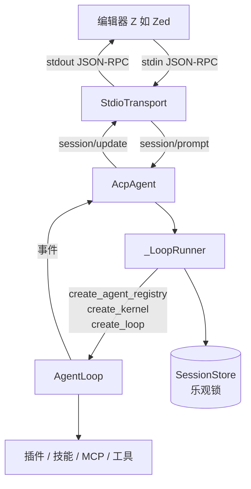

# ACP（Agent Client Protocol）接入

lite-work 可以作为 **ACP Agent** 被编辑器直接驱动：编辑器（Client）把
`lite-work acp` 当子进程拉起，通过 stdin/stdout 用 JSON-RPC 2.0 通信。

协议规范：<https://agentclientprotocol.com>（v1）

## 为什么值得接

- **零适配成本**：Zed / JetBrains 等 ACP 客户端直接可用，不需要为每个编辑器
  写扩展；
- **复用全部能力**：ACP 模式下跑的就是完整的 lite-work AgentLoop——插件、
  技能、MCP、上下文压缩、审批门、多 Agent 编排全都生效，与桌面版同源；
- **stdio 传输**：没有端口、没有鉴权、没有后台进程要管理，编辑器退出即回收。

## 快速接入（Zed）

终端里验证能跑通：

```bash
lite-work acp --config-dir ~/.lite-work --log-level info
```

它会静默等待 stdin 上的 JSON-RPC（**stdout 只输出协议消息**，日志全在 stderr）。

在 Zed 的 `settings.json` 里加：

```json
{
  "agent_servers": {
    "lite-work": {
      "type": "custom",
      "command": "/path/to/lite-work-backend/lite-work-backend",
      "args": ["acp"],
      "env": {
        "DEEPSEEK_API_KEY": "sk-..."
      }
    }
  }
}
```

> **`"type": "custom"` 不能省**：Zed 靠它区分「自定义 Agent」与注册表安装的
> Agent，漏了就根本不出现在 Agent 选择器里。也可走 UI：`agent: open settings`
> → External Agents → `Add Agent` → `Add Custom Agent`，它会预置好骨架。

开发态直接用 Python：

```json
{
  "agent_servers": {
    "lite-work": {
      "type": "custom",
      "command": "/Users/you/codes/lite-work/.venv/bin/python",
      "args": ["-m", "litework", "acp"]
    }
  }
}
```

配置好后在 Zed 的 Agent 面板选择 `lite-work`，`session/new` 会带上你在编辑器里
打开的项目路径作为 `cwd`，Agent 就在那个目录里干活。

## 已实现的方法

| 方法 | 类型 | 说明 |
| --- | --- | --- |
| `initialize` | request | 握手，返回 `protocolVersion: 1` 与能力声明 |
| `session/new` | request | 新建会话，返回 `sessionId` |
| `session/load` | request | 恢复已有会话：先按序重放整段历史，再返回 `{}` |
| `session/prompt` | request | 跑一个完整 turn，期间流式推送 `session/update` |
| `session/cancel` | notification | 中断运行中的 turn，`prompt` 回 `stopReason: "cancelled"` |

`session/update` 推送三类：`agent_message_chunk`（文本）、`tool_call` /
`tool_call_update`（工具调用状态与结果）、`user_message_chunk`（仅重放时）。

审批走 **Agent → Client 反向请求** `session/request_permission`：写文件、
执行命令等需要确认的操作会弹在编辑器里，用户点「允许」才继续。
不接这个桥的后果很实际——工具会挂到审批门 600s 超时被拒，用户看到的是
「Agent 卡了十分钟然后失败」。

## 明确**不**声明支持的能力

能力声明是「不谎报」原则的体现——客户端会依据 `agentCapabilities` 决定调不调用，
谎报会让客户端拿到残缺结果，比不支持更糟：

- `loadSession` —— **会按实际情况动态声明**：注入了 history_loader 才是 `true`。
  历史重放的映射规则见 `replay_updates()`：user → `user_message_chunk`、
  assistant → `agent_message_chunk`、工具调用展开成 `tool_call` +
  `tool_call_update` 且 **status 固定 completed**（重放一个「正在运行」的旧工具
  会让客户端永远转圈）；`system` 消息与悬空工具调用跳过。
- `promptCapabilities.image/audio/embeddedContext: false` —— 只取 text 内容块，
  其余静默跳过；
- 不实现 `terminal/*`、slash commands、session modes、`session/resume` /
  `session/delete`。

## 架构



| 文件 | 职责 |
| --- | --- |
| `litework/acp/transport.py` | JSON-RPC over stdio；**stdout 保护**、错误处理、请求分发 |
| `litework/acp/agent.py` | ACP 方法实现（与传输层解耦，便于单测） |
| `litework/acp/runner.py` | 装配 `AgentApp` / kernel / AgentLoop，会话历史复用 |
| `litework/acp/tools.py` | 工具事件 → `tool_call`/`tool_call_update` 映射 |
| `litework/acp/permissions.py` | 审批门 ↔ `session/request_permission` 双向桥 |
| `litework/cli.py` | `acp` 子命令入口 |

## 三个必须守住的约束

### 1. stdout 只能是合法 JSON-RPC

协议原文：*"The agent **MUST NOT** write anything to its stdout that is not a
valid ACP message."*

项目里任何插件、工具或第三方库随手一个 `print()`，都会往 stdout 吐一行非 JSON
——客户端解析失败就认为 Agent 崩了，而现象是「连上几秒后断开」，极难与业务
bug 区分。

因此 `run_acp` 在**构造 AgentApp 之前**就调用 `capture_stdout()`：先把真实
stdout `dup` 出来专供协议使用，再把 fd 1 重定向到 fd 2（stderr），并让
`sys.stdout = sys.stderr`。此后所有 print / logging 都落在 stderr，协议通道
天然干净。

### 2. `session/prompt` 必须可被 cancel 打断

一个 turn 可能跑几分钟。若是同步处理，读循环会被占住，`session/cancel` 通知
永远读不到——用户在编辑器里点「停止」毫无反应。所以传输层给每个请求开独立
task（`_dispatch_request`），读循环继续转。

取消时 `prompt` 必须**正常返回** `{stopReason: "cancelled"}` 而不是抛异常：
抛异常会让传输层回 JSON-RPC error，编辑器把「用户主动停止」显示成一次失败。

### 3. 单条消息不得含内嵌换行

帧边界就是 `\n`。`json.dumps` 会把内容里的换行转义成 `\n` 字面量，
天然满足；但如果手工拼字符串就会踩雷。`tests/test_acp.py` 里有专门用例。

## 会话与并发

- 每个 ACP 会话对应一个 lite-work session（复用同一份会话文件，落盘在
  `--config-dir`）；
- 同一会话的后续 turn 会加载已落盘的历史，否则第二轮会从空上下文开始；
- 同一会话不允许并发 turn（协议假定客户端串行，真撞上直接报错而不是静默并发）。

跨客户端/跨进程写同一会话由 `SessionStore` 的**乐观锁**保护：`save()` 支持
`expected_version`，版本不一致抛 `SessionConflictError` 而不是静默覆盖。

## 测试与认证

| 层次 | 命令 | 验证什么 |
| --- | --- | --- |
| 单元 | `pytest tests/test_acp.py tests/test_acp_advanced.py` | 57 项协议契约 |
| 基础 e2e | `python tests/e2e_acp.py` | 真实子进程握手/错误/退出 |
| **全链路** | `python scripts/verify-acp-flow.py` | **真 AgentLoop + 真工具 + 真审批** |

`scripts/verify-acp-flow.py` 是「不经编辑器也能证明它能干活」的关键：它起一个
**假 LLM 服务器**（标准 OpenAI 兼容 SSE，固定返回 tool_calls），后面全是生产
代码——真 AcpAgent、真 AgentLoop、真工具注册表、真审批门。

```bash
# 场景 A：用户在编辑器里点「允许」→ 文件真的被删掉
.venv/bin/python scripts/verify-acp-flow.py                    # 14/14

# 场景 B：用户点「拒绝」→ 文件必须仍在（反例证明审批真的拦住了）
ACP_E2E_DENY=1 .venv/bin/python scripts/verify-acp-flow.py     # 15/15
```

为什么造假 LLM：真 LLM 不可复现（同样 prompt 每次答案不同、要花钱、没网跑不了），
而审批与工具渲染的正确性只取决于「模型是否请求了某个工具」，与模型真假无关。

## 已知限制

- 只支持 text 内容块（图片/音频静默跳过）；
- 不支持 `terminal/*`、slash commands、session modes、`session/resume`；
- 工具 `kind` 是按工具名**子串推断**的（`read_file`→read、`write`→edit…），
  插件工具名千变万化，认不出来时 fallback `other`——只影响图标，不影响功能；
- 工具结果在 `session/update` 里截断到 4000 字符（完整结果仍在会话记录中）；
- 在 Windows 上 `connect_read_pipe` 不可用时会退回线程读取（未在真机验证）。
