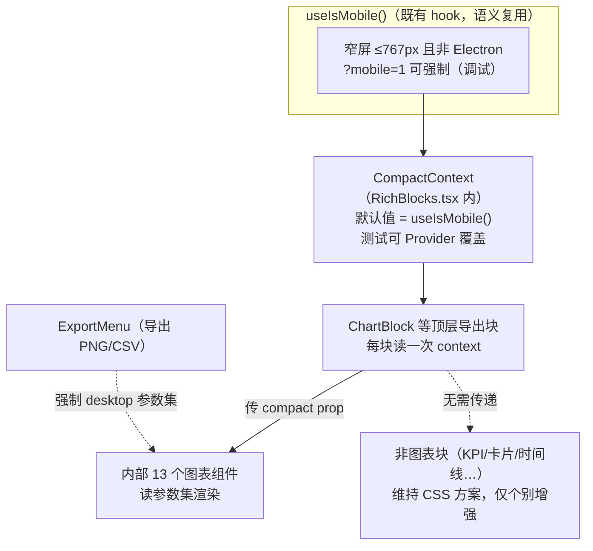

# 富块渲染层响应式（compact 主题）设计稿

> 状态：P1 + P2 + P3 已实施（2026-10，P3 以浏览器模拟验收）。关联：手机端 PWA 多客户端视图分离（2026-10）。
> 背景：富块（```chart / ```table / ```diagram 等围栏）此前按桌面 640px 画布
> 渲染，手机上靠 CSS 等比缩放兜底——字号被缩小 53%（10px→5.3px）不可读。
> 本方案在渲染层引入 compact 参数集，同一份 spec（模型输出的 JSON 不变）
> 渲染出小屏专属画法。

## 0. 设计原则

| # | 原则 | 含义 |
|---|---|---|
| P1 | spec 不变，渲染双轨 | compact 是纯渲染层开关。同一会话多端共享，桌面看桌面版、手机看手机版（不选「LLM 端感知设备」方案的原因） |
| P2 | CSS 兜底保留 | compact 是增强不是依赖——JS 判断失效时，CSS 缩放/滚动兜底仍保证不破版 |
| P3 | 桌面字节级不变 | desktop 参数集与改造前完全一致，桌面测试零回归是验收线 |
| P4 | 触控优先 | 点按目标 ≥ 40px；字号下限 10px 物理像素 |
| P5 | 渐进迁移 | 按使用频率分期（P1 五类高频图 → P2 其余） |

## 1. 架构：compact 的传播机制



关键决策：

- 不走每组件各自 `useIsMobile()`（21 个组件 × 21 个 matchMedia 监听，
  且测试无法注入）——用一个模块内 `CompactContext`，顶层块读一次、
  prop 下传；
- 导出路径强制 desktop：PNG 导出若序列化当前 DOM 的 SVG，compact
  视口会导出小图，导出时用 desktop 参数重渲染。

## 2. 参数集定义

```ts
// chartTheme.ts（纯数据无副作用）
export interface ChartDims {
  W: number; padL: number; padR: number; padT: number; padB: number; plotH: number;
}
export interface ChartFonts {
  axis: number;   // 轴刻度
  label: number;  // x 轴类目 / 图例
  val: number;    // 数据点标注
}

// 尺寸推导：气泡可用宽 = 视口 375 − msg-row 2×10 − bubble 2×12 − md-chart 2×12 ≈ 307px
// compact W 定 300 → 手机上近乎 1:1 渲染，字号即物理字号
export const BAR: Record<"d" | "m", ChartDims> = {
  d: { W: 640, padL: 50, padR: 14, padT: 16, plotH: 230, padB: 44 },   // = 改造前，字节不变
  m: { W: 300, padL: 34, padR: 10, padT: 14, plotH: 170, padB: 34 },
};
export const FONTS: Record<"d" | "m", ChartFonts> = {
  d: { axis: 10,   label: 10.5, val: 9.5 },
  m: { axis: 10.5, label: 10.5, val: 10   },  // 物理不缩，微升
};
```

每个图表组件的改法是机械的：`const { W, padL, … } = BAR[compact ? "m" : "d"]`，
字号同理。无一处三元逻辑散落在绘制代码里。

## 3. 十三类图表参数表

| 图表 | compact 尺寸变化 | 密度策略 | 触控/可读性 | 期 |
|---|---|---|---|---|
| Bar | W 640→300，plotH 230→170 | y 网格 5→3 线；showVals 阈值 n≤10→n≤6；x 标签截断 10→5 字，n>6 时隔一个显示 | barW 上限 30→24 | P1 |
| Line / Area | 同 Bar | 同上（隔标签） | 数据点半径 2.6→3.4 | P1 |
| HBar | W 640→300，padL 128→80 | 类目标签截断 14→8 字 | 行高不变 | P1 |
| Pie | viewBox 260→220（R 92→80，IR 58→50） | 图例右排→下方（CSS 列方向） | 中心总数字号 13→12，pct 标注不变 | P1 |
| Combo（双轴） | W 640→300，padR 56→34 | 两轴刻度字号同 FONTS | — | P1 |
| Scatter | W 640→300 | — | 点半径 3→4.2 | P2 |
| Boxplot | W 640→300 | — | 箱宽下限 22→18 | P2 |
| Histogram | W 640→300 | 分箱数不变（数据驱动） | — | P2 |
| Waterfall | W 640→300 | 小计柱标签同 showVals 规则 | — | P2 |
| Stacked / stacked-area | W 640→300 | — | — | P2 |
| Radar | size 300→270，R 105→86 | 轴标签截断 8→5 字 | 顶点 r 2.6→3.2 | P2 |
| Heatmap | 无需改动（W = f(cols×cell) 自适应） | — | — | — |
| Mermaid | 不做（第三方布局，CSS 兜底；远期可传 compact 主题） | — | — | P3 |

## 4. 非图表块：维持 CSS，三处增强

| 块 | 现状（CSS 已覆盖） | compact 增强 | 期 |
|---|---|---|---|
| Table | 横滚 | 冻结首列（th/td:first-child sticky + 底色），长表滚动时类目不丢 | P2 |
| Board（看板） | 2 列网格堆叠 | 列数 ≥3 时改横滑 + scroll-snap（每列一屏宽，保列语义） | P2 |
| Diagram / Interactive | SVG viewBox 缩放 + 56dvh 限高 | renderShape 加 compact 参数：label 字号 ×1.15、每 part 追加透明命中矩形（≥44px）；pill 单列纵排 | P2 |
| KPI / Cards / Timeline / Compare / Progress | 单/双列堆叠 | 无需增强 | — |

## 5. 触控规范（全局）

- SVG 交互元素（diagram part、scatter/line 数据点、pie 扇区）：命中区
  ≥ 40×40px，不足的垫透明 rect；
- pill/tab 按钮：`min-height: 36px`；
- `:active` 态已有 `scale(0.98)`，保留。

## 6. 测试策略

| 层 | 做法 |
|---|---|
| 单元 | vitest + `CompactProvider value={true}` 强制：断言 `svg viewBox="0 0 300 …"`、网格线数、标签截断长度；desktop 断言现状值（防回归） |
| 组件 | 既有 ChatView.test 不动（jsdom 无 matchMedia → 默认 desktop，天然零回归） |
| 视觉 | `?mobile=1` 下逐块截图比对 |
| 导出 | 断言 compact 视口下导出的 PNG 尺寸 = desktop W |

## 7. 分期与工作量

- P1 ✅：主题基建（chartTheme.ts + CompactContext）+ Bar/Line/HBar/Pie/Combo
  + 触控规范（pill 36px / 数据点半径）+ 22 项单测；
- P2 ✅：Scatter/Box/Hist/Waterfall/Stacked/Radar + 表格冻结首列 +
  看板横滑 scroll-snap + diagram label ×1.15；
- P3 ✅（浏览器模拟验收）：mermaid compact（fontSize 15，模式切换重
  initialize）；视觉验证用 esbuild stdin 打包 + Playwright 375px 截图
  替代真机（无 iPhone 时），截图发现并修复 2 个问题：冻结首列折行
  （补 nowrap）与饼图图例挤压（gap 10px）。
- 实施备注：R1 导出取 compact DOM 的决定——compact 视口导出 PNG 即
  compact 版（所见即所得），不做离屏 desktop 重渲染；P2 diagram 的
  「透明命中矩形 ≥44px」未实现（renderShape 不改结构，靠 pill 36px 与
  SVG part 组的整组点击近似），真机体验不足时再补。

P1 完成即覆盖最高频路径（bar/line/pie 占富块产出的绝大多数）。

## 8. 风险与开放问题

| # | 风险 | 缓解 |
|---|---|---|
| R1 | 导出路径可能序列化当前 compact DOM → 小图 | 实现时先验证；不行就导出走离屏 desktop 渲染 |
| R2 | compact 判定与移动壳判定不一致（Electron 窄窗） | 复用 useIsMobile 同一语义，天然一致（桌面红线不变） |
| R3 | 300px 画布放不下大数据集（如 20 个类目） | compact 截断更狠 + 隔标签；极端情况后续可加「查看大图」全屏态（不在本设计范围） |
| R4 | 平板 PWA（768px+）拿到桌面布局 | 既有行为，本设计不改变 |
